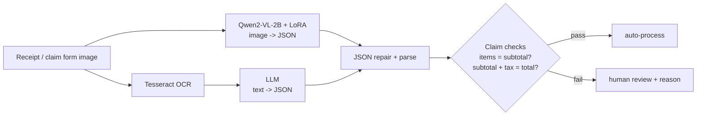

# 🧾 Claim Document AI: Fine-tuned Qwen2-VL for Receipts and Claim Forms

> Turns photographed receipts and scanned claim forms into clean, validated JSON. A vision-language model (Qwen2-VL, fine-tuned with QLoRA on a free GPU) reads the *image* directly, so layout is not lost the way it is in the usual OCR-then-LLM pipeline. Every receipt is then checked against its own arithmetic before a claim is auto-processed.

    

## Why

Insurance and expense claims arrive as receipts, invoices and filled-in forms. The common pipeline is **OCR → text → LLM**, and it fails in predictable ways: OCR scrambles columns, so the LLM pairs the wrong price with the wrong item, or a form label with the wrong answer. A vision-language model sees where things are on the page. This project measures how much that matters, on public benchmarks, against the same prompt and the same scoring.



## What's inside

- **Fine-tuning:** QLoRA (4-bit, LoRA r=16 on attention + MLP) on CORD-v2 (800 receipts) + FUNSD (149 forms). Loss is computed on the JSON answer only: prompt, image and padding tokens are masked. Fits a free Colab T4.
- **Baseline:** Tesseract OCR (line-grouped, reading order) + an LLM: a free local Qwen2.5-1.5B, or Claude / GPT via API.
- **Same prompt for every system** (`prompts.py`), so the comparison isolates the model.
- **Robust JSON parsing:** code fences, chatter, single quotes, trailing commas and replies cut off at the token limit are repaired; the number of failures is reported per system.
- **Field-level F1** (CORD-standard): prediction and gold are flattened to (field path, value) pairs, order-independent multiset matching; FUNSD key → value pairs count as one field. Loose (case/space-insensitive) and strict variants, plus perfect-document rate and per-field F1.
- **Claim validation:** a locale-tolerant amount parser ("48.000", "1,250.00", "12,49", "Rp. 39.000") and arithmetic checks (items vs. subtotal, subtotal + tax + service − discount vs. total). Receipts that add up are `auto_ready`; the rest go to review with the reason.
- **Serving:** FastAPI `POST /extract` (image → JSON + claim checks) and a Streamlit claims-desk demo.

## Results

Run [`notebooks/train_eval_colab.ipynb`](notebooks/train_eval_colab.ipynb) on a free Colab T4 (≈ 3 hours). It fills this table on the official test splits:

| System | CORD field F1 (100 receipts) | FUNSD field F1 (50 forms) | JSON failures | Receipts auto-ready | s / doc |
|---|---:|---:|---:|---:|---:|
| Qwen2-VL-2B zero-shot | _run notebook_ | _run notebook_ | | | |
| Tesseract OCR + LLM (baseline) | _run notebook_ | _run notebook_ | | | |
| **Qwen2-VL-2B + QLoRA (this project)** | _run notebook_ | _run notebook_ | | | |

## Quickstart

```bash
git clone https://github.com/alihassan891u-lab/claim-document-ai.git && cd claim-document-ai
pip install -e ".[dev]" && pytest -q          # CPU-only tests, including a real Tesseract OCR run

# GPU machine / Colab
pip install -e ".[gpu,ocr,llm]"
python -m claimdoc.finetune --out outputs/qwen2vl-claims-lora --epochs 2
python -m claimdoc.evaluate --systems zero-shot,lora,ocr-llm --baseline-llm hf

CLAIMDOC_SYSTEM=lora CLAIMDOC_ADAPTER=outputs/qwen2vl-claims-lora uvicorn claimdoc.api:app --port 8000
curl -F "file=@receipt.jpg" -F "doc_type=receipt" localhost:8000/extract
```

## Project layout

```
src/claimdoc/
  datasets.py   CORD-v2 (HF Hub or local) and FUNSD loaders; FUNSD links -> key/value pairs in reading order
  prompts.py    one instruction per document type, shared by all systems
  vlm.py        Qwen2-VL / Qwen2.5-VL inference (pixel budget tuned for a T4), optional LoRA adapter
  finetune.py   QLoRA training, assistant-only loss masking
  baseline.py   Tesseract OCR + LLM (local HF model, Claude or OpenAI)
  parsing.py    JSON extraction and repair
  metrics.py    field-level precision / recall / F1, per-field F1, perfect-document rate
  claim.py      amount parsing + receipt arithmetic checks -> auto_ready / needs_review
  evaluate.py   runs systems on the same documents, writes predictions and a comparison table
  api.py
app/streamlit_app.py
notebooks/train_eval_colab.ipynb
tests/          30 tests: loaders, metric reference values, JSON repair, amount parsing, claim checks,
                loss masking, and the OCR pipeline end to end with real Tesseract on a rendered receipt
```

## Data and licenses

CORD-v2 (NAVER Clova, CC BY 4.0): 1,000 Indonesian restaurant receipts, 800 / 100 / 100. FUNSD (Jaume et al., 2019): 199 noisy scanned forms, 149 / 50; check its license terms for your use. Qwen2-VL: see the model card. Code: MIT © Ali Hassan.
